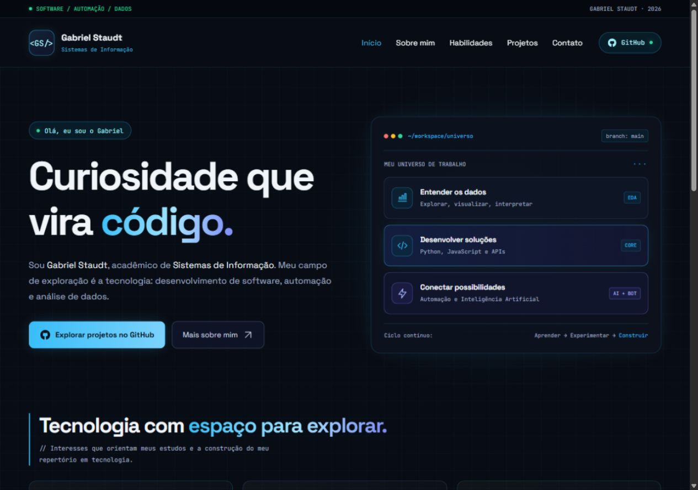
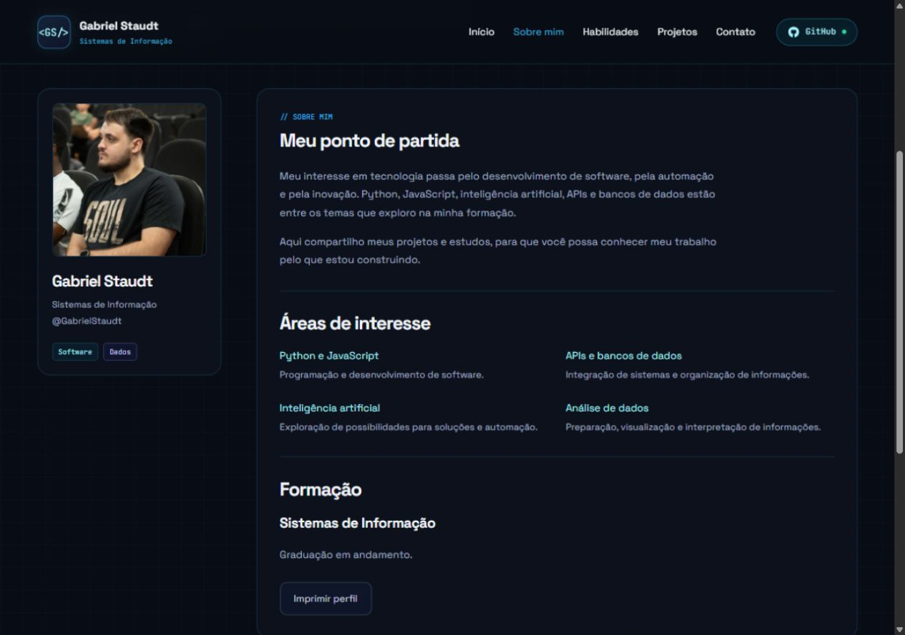
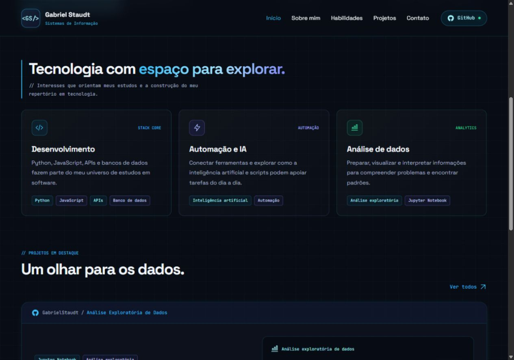
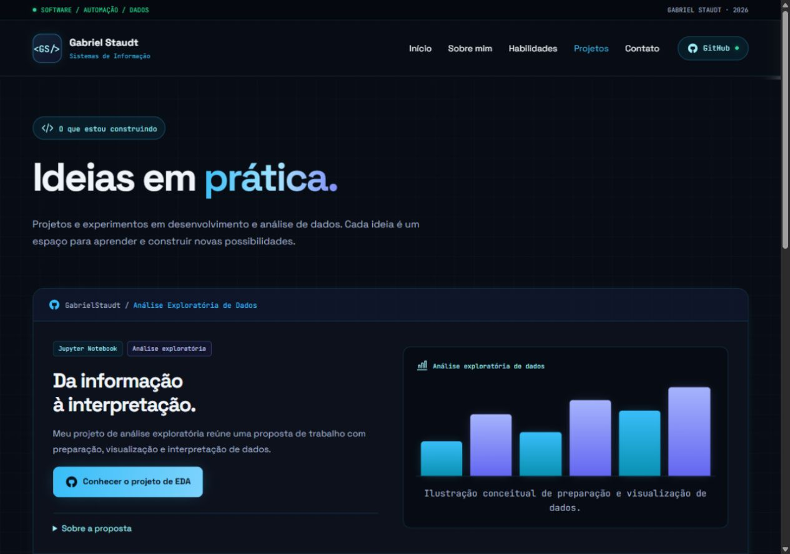
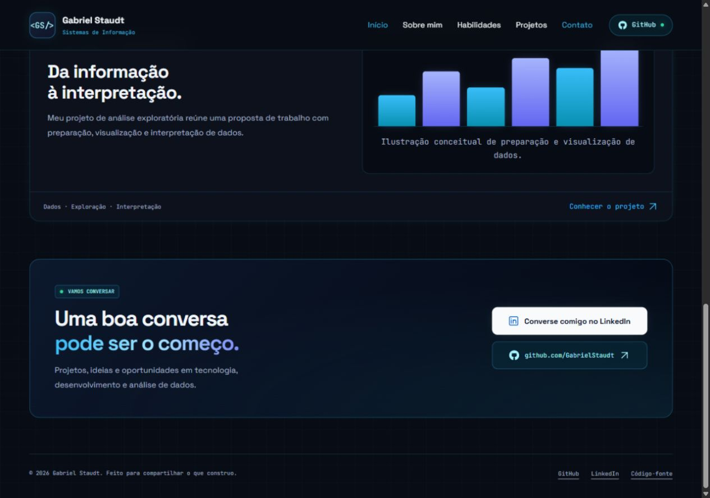
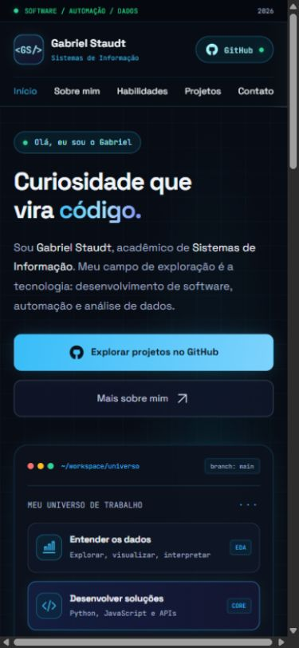

# 🚀 Portfólio | Gabriel Staudt

Portfólio pessoal com foco em desenvolvimento de software, automação e análise de dados, apresentando meus projetos, minha formação e meus interesses em tecnologia.

🔗 **[Acesse o portfólio](https://gabrielstaudt.github.io/portifolio/)**

---

## 🌐 Web

### 💻 Header e início



### 👤 Sobre mim



### 🚀 Habilidades



### 🧩 Projetos



### 📱 Contato



---

## 📱 Mobile



[Visualizar página mobile completa](./assets/screenshots/mobile/pagina-completa.jpg) · [Sobre mim](./assets/screenshots/mobile/sobre-mim.jpg) · [Projetos](./assets/screenshots/mobile/projetos.jpg)

---

## 🎨 Assets

Os arquivos utilizados estão separados em [assets/](./assets/):

| Pasta | Conteúdo |
| --- | --- |
| [icons](./assets/icons/) | Favicon e ícones SVG |
| [images](./assets/images/) | Foto de Gabriel |
| [fonts](./assets/fonts/) | Space Grotesk e JetBrains Mono, com suas licenças |
| [screenshots/desktop](./assets/screenshots/desktop/) | Capturas da versão web |
| [screenshots/mobile](./assets/screenshots/mobile/) | Capturas da versão mobile |

Veja a origem e a organização dos arquivos em [assets/README.md](./assets/README.md).

## 🛠️ Tecnologias

HTML, CSS, JavaScript e Node.js para gerar o site. Publicação automática no GitHub Pages.

## ▶️ Executar

Requer Node.js 22 ou superior. Sem instalação de pacotes.

```sh
npm run build
npm run check
```

Abra `dist/index.html` ou consulte o [guia de desenvolvimento](./docs/DESENVOLVIMENTO.md) para servir o site por HTTP, carregar os ícones SVG e visualizar todos os recursos.

## 🤝 Contribuição

Commits seguem Conventional Commits: `feat:`, `fix:`, `docs:` e `ci:`. Orientações em [CONTRIBUTING.md](./CONTRIBUTING.md).

## 📄 Licença e referências

Código sob [licença MIT](./LICENSE). Fontes sob SIL Open Font License.

Estrutura do README inspirada no [portfólio de Fabricyo Silva](https://github.com/FabricyoSilva/portifolio). Direção visual baseada na prévia HTML fornecida para este projeto.

---

[GitHub](https://github.com/GabrielStaudt) · [LinkedIn](https://www.linkedin.com/in/gabriel-bregalda-24745a268/)
